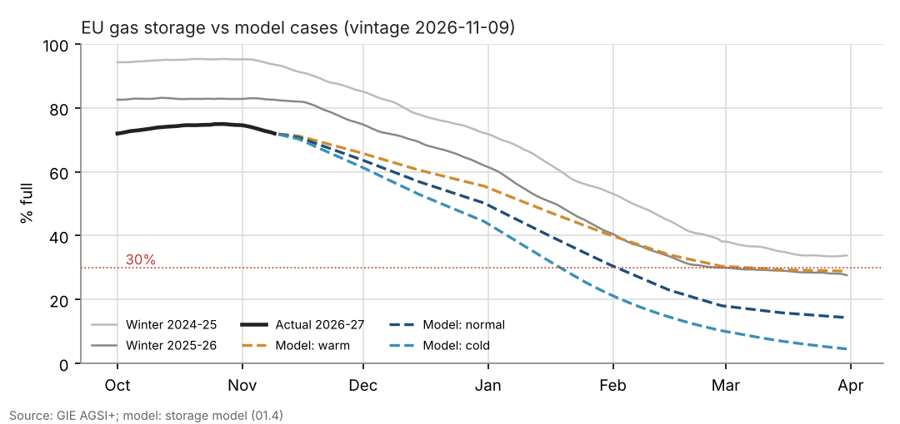
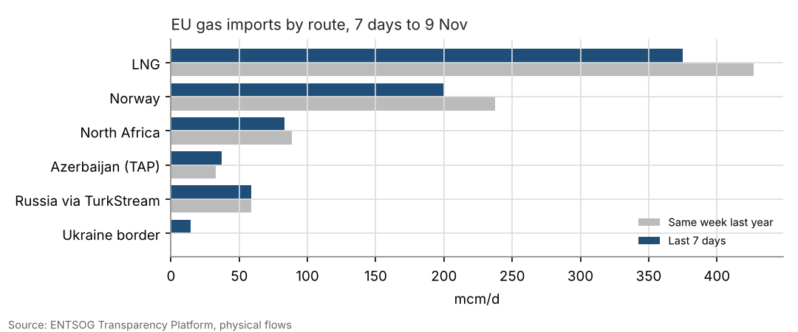
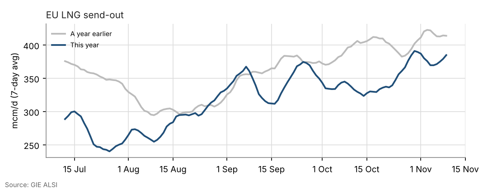

# European gas weekly: 13 November 2026

*Data to gas day 9 Nov 2026. Storage model vintage 2026-11-09. Draft until the author signs off the "So what".*

## The numbers
- **EU storage:** 72.0% full (815 TWh), against 82.5% a year earlier and 74.3% a week ago. Net withdrawals averaged 3.84 TWh/d over the last 7 days.
- **Against the model:** the model path starts after this date. The cases end March at 29% (warm), 14% (normal) and 5% (cold).
- **Imports:** 768 mcm/d over the last 7 days, -9% on the same week last year.
- **LNG send-out:** 385 mcm/d (7-day average), -7% y/y.

| Route | Last 7 days (mcm/d) | Same week last year | Change |
|---|---|---|---|
| LNG | 375 | 427 | -12% |
| Norway | 200 | 237 | -16% |
| North Africa | 83 | 88 | -6% |
| Azerbaijan (TAP) | 37 | 33 | +13% |
| Russia via TurkStream | 59 | 59 | -0% |
| Ukraine border | 15 | 0 | n/a |

## So what
*To be written by the author: what changed this week, whether the base-case call still holds, and what would change it.*

## Prices and positioning
- TTF and JKM daily prices are not in the free data set; quote the latest settlement with its source and date, and use the Numbers of Record sheet for any figure that also appears on the website.
- CFTC covers Henry Hub only. TTF positioning (ICE Commitments of Traders) has to be downloaded by hand each week.

*Sources: GIE AGSI+ and ALSI, ENTSOG Transparency Platform. 1 bcm = 10.55 TWh. Research for information only; not investment advice.*
